# WealthPass Redesign: Phase 0 Audit Report

**Date:** 2026-10-13  
**Branch:** `redesign`  
**Status:** Audit Complete (Read-Only)  
**Contract Verification:** No application models, views, forms, or API endpoints modified.

---

## 1. Frontend Source of Truth

We audited the repository file structure against `wealthpass/settings.py`, `build.sh`, and `Dockerfile`:

| Asset Directory / File | Status | Technical Role & Serving Mechanism | Recommendation |
| :--- | :--- | :--- | :--- |
| **`templates/`** | **LIVE** | Specified in `settings.TEMPLATES['DIRS']`. Serves all Django SSR views and mounts the SPA bundle. | **Primary target for redesign components and layouts.** |
| **`static/`** | **LIVE** | Specified in `settings.STATICFILES_DIRS`. Served by `whitenoise.middleware.WhiteNoiseMiddleware` at `STATIC_URL = 'static/'`. Contains compiled bundles and public icons. | **Destination for `static/css/tokens.css` and compiled assets.** |
| **`ui/`** | **LIVE SOURCE** | React 19 + TypeScript + Vite project source. Builds directly into `static/js/landing-react.js` and `static/css/landing-react.css`. | **Preserve exactly for SPA discovery workflows and client-side notifications.** |
| **`pages/`** | **DEAD** | Static mock HTML files (`loan.html`, `results.html`, etc.) created before Django conversion. Not referenced by `TEMPLATES` or `STATICFILES_DIRS`. | Keep archived per No-Break Contract Rule 6 until Phase 8. |
| **`styles/`** | **DEAD** | Static CSS files (`global.css`, `pages.css`) from legacy mockups. Not listed in `STATICFILES_DIRS` (Django serves from `static/css/style.css`). | Keep archived per Rule 6 until Phase 8. |
| **`images/`** | **DEAD** | Static mock images (`hero.png`, `step1.png`, etc.). Live images are served from `static/assets/` or `ui/public/`. | Keep archived per Rule 6 until Phase 8. |
| **`index.html`** (root) | **DEAD** | Pre-Django root static mock file. Django serves `templates/landing.html` at `/`. | Keep archived per Rule 6 until Phase 8. |

---

## 2. Complete Route Inventory

### A. Public & Marketing Pages
| URL Path | Route Name | View Function / Class | Template Used | Auth Required | Risk |
| :--- | :--- | :--- | :--- | :--- | :--- |
| `/` | `landing` | `claims.views.landing` | `templates/landing.html` (React root) | No | Low |
| `/search/` | `search` | `claims.views.search` | `templates/search.html` | No | Medium |
| `/how-it-works/` | `how_it_works` | `claims.views.landing` | `templates/landing.html` | No | Low |
| `/discover-assets/` | `discover_assets_page` | `claims.views.landing` | `templates/landing.html` | No | Low |
| `/guide/banks/` | `bank_directory_view` | `forms_guide.views.bank_directory_view` | `templates/forms_guide/bank_directory.html` | No | Medium |
| `/guide/fill-form/` | `fill_form_online` | `forms_guide.views.fill_form_online_view` | `templates/forms_guide/fill_form_online.html` | No | Medium |
| `/guide/fill-form/print/` | `fill_form_print` | `forms_guide.views.fill_form_print_view` | `templates/forms_guide/print_form_document.html` | No | Low |
| `/energy/` | `energy_benchmark_root` | `forms_guide.views.energy_benchmark_view` | `templates/forms_guide/energy_benchmark.html` | No | Low |
| `/terms/` | `terms_page` | `claims.views.landing` | `templates/landing.html` | No | Low |
| `/privacy-policy/` | `privacy_policy_page` | `claims.views.landing` | `templates/landing.html` | No | Low |
| `/404/` | `404_page` | `claims.views.landing` | `templates/landing.html` | No | Low |

### B. Session & Claim Workflow Pages
| URL Path | Route Name | View Function / Class | Template Used | Auth Required | Risk |
| :--- | :--- | :--- | :--- | :--- | :--- |
| `/verify/<session_id>/` | `verify` | `claims.views.verify` | `templates/verify.html` | Session valid | Medium |
| `/results/<session_id>/` | `results` | `claims.views.results` | `templates/results.html` | Session valid | High |
| `/loan/<session_id>/` | `loan` | `claims.views.loan` | `templates/loan.html` | Session valid | Medium |
| `/accept-loan/<session_id>/` | `accept_loan` | `claims.views.accept_loan` | Redirects to `success` | Session valid (POST) | Medium |
| `/success/<session_id>/` | `success` | `claims.views.success` | `templates/success.html` | Session valid | Low |
| `/print-forms/<session_id>/` | `print_forms` | `claims.views.print_forms` | `templates/print_forms.html` | Session valid | Low |
| `/claims/<session_id>/fill-online/` | `online_claim_form` | `claims.views.online_claim_form` | `templates/online_claim_form.html` | Session valid | High |
| `/claims/<session_id>/copilot/` | `claim_copilot_workspace` | `claims.views.claim_copilot_workspace` | `templates/copilot_workspace.html` | Session valid | High |

### C. Authentication & User Account APIs (`accounts/urls.py`)
All routes under `/api/auth/` (`register/`, `login/`, `verify-email/`, `send-otp/`, `verify-otp/`, `me/`, `logout/`, `csrf/`, `change-password/`, `activity/`). These are REST JSON endpoints consumed by the React app and session handlers. (Risk: **Protected - Visual redesign does not modify view contracts**).

### D. Notification APIs (`notifications/urls.py`)
Routes under `/api/notifications/` (`unread-count/`, `read/`, `mark-all-read/`, `stream/`). Consumed via SSE / Polling by `NotificationOverlay`. (Risk: **Protected**).

---

## 3. Template Inheritance & Block Map

```mermaid
graph TD
  Base["core/base.html<br/>Blocks: extra_css, content"]
  
  Base --> Search["search.html<br/>Blocks: extra_css, content"]
  Base --> Verify["verify.html<br/>Blocks: extra_css, content"]
  Base --> Results["results.html<br/>Blocks: extra_css, content"]
  Base --> Loan["loan.html<br/>Blocks: extra_css, content"]
  Base --> Success["success.html<br/>Blocks: extra_css, content"]
  Base --> OnlineForm["online_claim_form.html<br/>Blocks: extra_css, content"]
  Base --> Copilot["copilot_workspace.html<br/>Blocks: title, extra_css, content"]
  Base --> BankDir["forms_guide/bank_directory.html<br/>Blocks: title, extra_css, content"]
  Base --> EnergyBench["forms_guide/energy_benchmark.html<br/>Blocks: title, extra_css, content"]
  Base --> FillOnline["forms_guide/fill_form_online.html<br/>Blocks: title, extra_css, content"]

  Standalone1["landing.html (React root)"]
  Standalone2["print_forms.html (Print CSS layout)"]
  Standalone3["forms_guide/print_form_document.html (Clean print layout)"]
```



---

## 4. Form Fields & JavaScript Selector Hook Map

To obey the **No-Break Contract Rule 2**, every form field, ID, and JS selector must remain completely intact:

### 1. `search.html` (Primary Asset Search)
* **Form**: `<form id="search-form" action="" method="POST">`
* **Form Inputs**:
  * `deceased_name` (`type="text"`, required)
  * `pan_number` (`type="text"`, required)
  * `death_certificate_no` (`type="text"`, required)
  * `death_certificate_file` (`id="file-upload"`, `type="file"`, accept `.pdf,.png,.jpg,.jpeg`)
  * `claimant_name` (`type="text"`, required)
  * `aadhaar_last4` (`type="text"`, maxlength="4", required)
  * `relation` (`id="native-relation-select"`, `<select>`, required)
  * `mobile` (`type="text"`, required)
  * `affidavit` (`id="affidavit"`, `type="checkbox"`, required)
  * `submit-btn` (`id="submit-btn"`, `type="submit"`)
* **Sacred JS Element IDs**:
  `affidavit`, `custom-relation-dropdown`, `drag-zone`, `file-sub`, `file-title`, `file-upload`, `form-error`, `hackathon-trigger`, `loader-overlay`, `native-relation-select`, `phrase-1`, `phrase-2`, `phrase-3`, `search-form`, `submit-btn`
* **JS Classes**: `.custom-select-option`, `.custom-select-options`, `.custom-select-trigger`

### 2. `forms_guide/fill_form_online.html` (Online RBI Claim Preparation)
* **Form**: `<form id="onlineClaimForm" action="/guide/fill-form/print/" method="POST">`
* **Form Inputs**:
  * `bank_name` (`type="hidden"`)
  * `annex` (`type="hidden"`)
  * `deceased_name` (`id="deceased_name"`, required)
  * `date_of_demise` (`id="date_of_demise"`, required)
  * `account_number` (`id="account_number"`, required)
  * `death_cert_no` (`id="death_cert_no"`, required)
  * `branch_name` (`id="branch_name"`)
  * `branch_ifsc` (`id="branch_ifsc"`)
  * `claimant_name` (`id="claimant_name"`, required)
  * `relationship` (`id="relationship"`, required)
  * `claimant_mobile` (`id="claimant_mobile"`, required)
  * `claimant_address` (`id="claimant_address"`)
  * `settlement_bank` (`id="settlement_bank"`)
  * `settlement_account` (`id="settlement_account"`)
  * `legal_heirs` (`id="legal_heirs"`, `<textarea>`)
  * `surety_1` (`id="surety_1"`), `surety_2` (`id="surety_2"`)
  * `locker_number` (`id="locker_number"`), `key_number` (`id="key_number"`)
  * `statutory_decl` (`id="statutory_decl"`, `type="checkbox"`, required)
* **Sacred JS Element IDs**:
  `account_number`, `assistLangLabel`, `branch_ifsc`, `branch_name`, `claimant_address`, `claimant_mobile`, `claimant_name`, `date_of_demise`, `death_cert_no`, `deceased_name`, `fieldTipText`, `fieldTipTitle`, `key_number`, `legal_heirs`, `locker_number`, `relationship`, `settlement_account`, `settlement_bank`, `statutory_decl`, `surety_1`, `surety_2`

### 3. `forms_guide/bank_directory.html` (Bank Directory & Wealth Buddy)
* **Wealth Buddy Assistant Query Form**:
  * `buddyQueryInput` (`id="buddyQueryInput"`, `type="text"`)
  * `buddySubmitBtn` (`id="buddySubmitBtn"`, `type="submit"`)
* **Sacred JS Element IDs**:
  `buddyAvatarWrap`, `buddyQueryInput`, `buddySubmitBtn`, `langLabel`, `langToggleBtn`, `largeTextToggleBtn`, `speechBubble`, `speechCitation`, `speechText`, `speedLabel`, `speedToggleBtn`, `voiceBtnText`, `voiceIcon`, `voiceToggleBtn`

### 4. `copilot_workspace.html` & `online_claim_form.html`
* **Form Inputs**: `deceased_name`, `policy_number`, `cause_of_death`, `uan`, `member_id`, `company_cin`, `folio_number`, `demat_boid`, `amc_name`, `account_number`, `branch_name_ifsc`, `date_of_death`, `claimant_name`, `claimant_capacity`, `settlement_account_no`, `settlement_ifsc`, `statutory_declaration`.
* **Sacred JS Element IDs**:
  `ackNumberInput`, `autosaveIndicator`, `branchInput`, `checklistProgressCounter`, `displayStatusTag`, `gExpectedFormat`, `gExplanation`, `gFieldLabel`, `gMandatoryBadge`, `gOfficialSource`, `gSupportingDocs`, `gWhereToFind`, `onlineClaimForm`, `submissionRecordForm`, `submitBtn`, `runAiBtn`, `aiFillStatus`

### 5. `loan.html` (Bridge Loan Support)
* **Form**: `<form id="loan-form" action="" method="POST">`
* **Inputs**: `loan-affidavit` (`id="loan-affidavit"`, `type="checkbox"`), `loan-btn` (`id="loan-btn"`)
* **Sacred JS Element IDs**:
  `auth-amount-text`, `btn-amount-text`, `display-loan-amount`, `loan-affidavit`, `loan-btn`, `loan-slider`

### 6. `core/base.html` (Global Shell)
* **Sacred JS Element IDs**:
  `acceptCookies`, `closeMenu`, `cookieBanner`, `global-glow`, `mobileMenu`, `mobileOverlay`, `openMenu`, `progressBar`
* **JS Classes**: `.glass-card`

---

## 5. Third-Party UI & CDN Dependencies Currently Loaded

| Template | Third-Party Scripts & CDNs | Local Static Stylesheets |
| :--- | :--- | :--- |
| `core/base.html` | `https://unpkg.com/@phosphor-icons/web` | `static/css/style.css`, `static/js/app.js` |
| `landing.html` | Google Fonts (`Almarai`, `Instrument Serif`) | `static/css/landing-react.css`, `static/js/landing-react.js` |
| `forms_guide/*.html` | None (vanilla HTML/JS) | Inherited from `core/base.html` |
| `copilot_workspace.html` | None (vanilla HTML/JS) | Inherited from `core/base.html` |

---

## 6. Baseline Verification Evidence

### A. Existing Django Test Suite
Ran full test suite across all apps (`claims`, `accounts`, `notifications`, `forms_guide`):
```text
Ran 151 tests in 241.185s
OK
Destroying test database for alias 'default'...
Found 151 test(s).
System check identified no issues (0 silenced).
```
**Result: 151 / 151 tests PASS with 0 failures.**

### B. Full-Page Multi-Viewport Baseline Screenshots Captured
Captured 42 full-page reference screenshots across all 14 routes at 375px, 768px, and 1280px into `docs/baseline_screenshots/`:

* `home_mobile_375px.png`, `home_tablet_768px.png`, `home_desktop_1280px.png`
* `search_mobile_375px.png`, `search_tablet_768px.png`, `search_desktop_1280px.png`
* `verify_session_mobile_375px.png`, `verify_session_tablet_768px.png`, `verify_session_desktop_1280px.png`
* `results_session_mobile_375px.png`, `results_session_tablet_768px.png`, `results_session_desktop_1280px.png`
* `loan_session_mobile_375px.png`, `loan_session_tablet_768px.png`, `loan_session_desktop_1280px.png`
* `claim_fill_online_mobile_375px.png`, `claim_fill_online_tablet_768px.png`, `claim_fill_online_desktop_1280px.png`
* `claim_copilot_mobile_375px.png`, `claim_copilot_tablet_768px.png`, `claim_copilot_desktop_1280px.png`
* `guide_banks_mobile_375px.png`, `guide_banks_tablet_768px.png`, `guide_banks_desktop_1280px.png`
* `guide_fill_form_mobile_375px.png`, `guide_fill_form_tablet_768px.png`, `guide_fill_form_desktop_1280px.png`
* `energy_benchmark_mobile_375px.png`, `energy_benchmark_tablet_768px.png`, `energy_benchmark_desktop_1280px.png`
* `discover_assets_mobile_375px.png`, `discover_assets_tablet_768px.png`, `discover_assets_desktop_1280px.png`
* `terms_mobile_375px.png`, `terms_tablet_768px.png`, `terms_desktop_1280px.png`
* `privacy_policy_mobile_375px.png`, `privacy_policy_tablet_768px.png`, `privacy_policy_desktop_1280px.png`
* `not_found_mobile_375px.png`, `not_found_tablet_768px.png`, `not_found_desktop_1280px.png`

**Total: 42 / 42 verified screenshots saved.**

---

## 7. Page-by-Page Risk Rating & Proposed Migration Order

| Order | Page / Template | Risk Rating | Key Rationale & Risk Factors |
| :---: | :--- | :---: | :--- |
| **0** | **Design Tokens & `core/base.html` Shell** | **Low** | Global foundations (`tokens.css`). Defines CSS custom properties, Inter font, responsive container, and navbar shell without altering view logic. |
| **1** | **Marketing Landing Page (`templates/landing.html`)** | **Low** | Entry point. No complex forms; connects directly to discovery and search flows. |
| **2** | **Error Pages (`404.html` / `500.html`) & Static Legal (`terms`, `privacy-policy`)** | **Low** | Static informative pages. No transactional or form submission risks. |
| **3** | **Search Form (`templates/search.html`)** | **Medium** | Essential customer input form. Contains PAN formatting, file drag-and-drop, and animated loader phrases. Must strictly preserve all field names and submit events. |
| **4** | **Verification Flow (`templates/verify.html`)** | **Medium** | OCR display and verification panels. Needs to retain `#ocr-panel` and `#final-card`. |
| **5** | **Results & Dossier (`templates/results.html`)** | **Medium** | Renders discovered asset breakdown and `#total-counter`. |
| **6** | **Bank Directory & Wealth Buddy (`templates/forms_guide/bank_directory.html`)** | **Medium** | Interactive voice synthesis and bilingual Q&A. Must preserve all 14 Buddy button/input IDs. |
| **7** | **Online Form Preparation (`templates/forms_guide/fill_form_online.html`)** | **High** | 21 form fields mapping to RBI Annexures. Any broken selector or input name breaks PDF printing. |
| **8** | **Bridge Loan Support (`templates/loan.html` & `success.html`)** | **Medium** | Contains slider calculation `#loan-slider` and affidavit consent. |
| **9** | **Claim Copilot Workspace (`templates/copilot_workspace.html` & `online_claim_form.html`)** | **High** | Real-time autosave indicators and field-level AI guidance. Most complex client-side state handling. |
| **10** | **Energy Benchmark Dashboard (`templates/forms_guide/energy_benchmark.html`)** | **Low** | Informational dashboard with telemetry tags. |

---

## Conclusion & Stop Condition
Phase 0 audit is complete. All 151 baseline unit tests pass, and all 42 reference screenshots are preserved.
**Awaiting approval of Phase 0 Report before starting Phase 1.**
